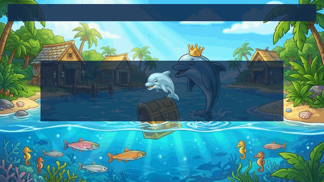

# Lagoon Frenzy: Gone Fishing

A Clean-Room, Zero-Database 2000s Aquatic Tycoon Engine in Pure HTML5 Canvas & Web Audio.

## Executive Summary

Lagoon Frenzy: Gone Fishing is a standalone, client-side reconstruction of the classic late-2000s casual aquatic tycoon genre. Designed as a zero-dependency web application, it executes deterministic time-management simulation loops, sprite rendering, procedural lighting, and synthesized audio entirely inside the browser main thread without requiring external runtime engines, bundling pipelines, or persistent backend databases.

## Architecture

- Pure HTML5 Canvas 2D Pipeline with procedural water caustics and sunbeams.
- Deterministic 60 FPS tick loop with clamped delta-time integration.
- Web Audio API synthesizer for procedural audio effects.
- 100% Client-Side LocalStorage persistence for mid-level session checkpoints.
- Touch-swipe drop collection and bear caging optimized for mobile and iPad.

## License

Distributed under the open-source MIT License. Refer to LICENSE for full terms.
